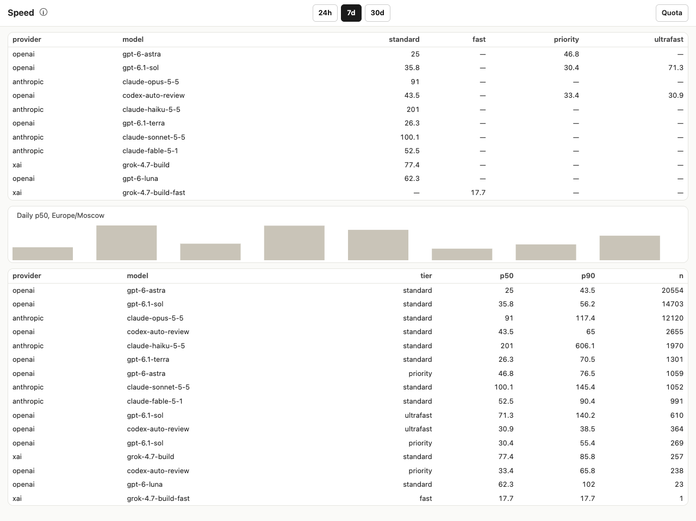

# Tokens per second — report

4 Nov 2026 request, built 5 Nov 2026 on `feat/tokens-per-second-20261104`.

Petr, 4 Nov 2026:

> I want a global 'tokens per second' tracknig for all models and providers AND the fast / ultrafast mode
> (for all ai chats) - on this mac

`ai-quotas speed scan` read this Mac's transcripts into `response_speed` (432,973 rows, schema `user_version` still 4). `ai-quotas speed` prints p50 / p90 tok/s. The dashboard page is `/speed`.

## Choices

- Speed tables are additive. `PRAGMA user_version` stays 4, so the sampler that is already running does not see a newer schema.
- `tokens_per_second` is `output_tokens / seconds`. Reasoning tokens are a subset of output tokens on Claude, Codex, and Grok, so they are stored and not added into the rate.
- `seconds` is end to end: the response's last timestamp minus the previous user message or tool result. It includes time to first token. A non-positive gap is stored with a null rate.
- Rows under 20 output tokens or under 0.3s stay in the table and drop out of the stats. Parallel tool batches and compaction turns do the same.
- Codex `default` is tier `standard`. `priority` and `ultrafast` keep those names. The page shows standard, fast, priority, and ultrafast side by side.
- Claude marks the *following* response when a message issued two or more tool calls, because the issuing window is model time before the tools return. Codex marks the token row that covers the batch. Stats skip either mark.
- Grok has no service tier. A model id containing `-fast` is tier `fast` (`grok-4.7-build-fast`). `modelCalls > 1` is several loops summed into one blob, so that row is stored and marked parallel. There is no per-call split.
- Grok's single-call clock is the timestamp delta (it matches `elapsed_ms`). `apiDurationMs` is model API time and is not the end-to-end clock.
- Muse is included. Its clock is `duration_ms` on `model_completed`, which is the per-call duration in that log. Tier stays `unknown` unless the model id contains `-fast`.
- Antigravity, Claude Desktop Cowork, and the model gateway are listed as no timing data. The gateway's spend log is remote Postgres and was not opened.
- Orca Codex homes that are hardlinks of `~/.codex` are read once (inode). Separate Orca runtime-home rollouts are included and collapse on `response_key`. Archived `.jsonl.zst` is streamed with `zstd -dc` when that binary exists.
- Timestamps are stored as Europe/Moscow ISO with milliseconds, so the daily bars and the SQL window bound share one calendar. On this Mac that matches local time.
- The scan agent is `com.calmmage.ai-quotas-speed`, every 10 minutes, prepared as `make install-speed` and wired into `make install-automation` and `make deploy`. It was not installed in this run.

## Fields found

| Harness | Clock and usage | Tier | This Mac |
| --- | --- | --- | --- |
| Claude Code `~/.claude/projects/**/*.jsonl` | Several assistant lines share `message.id`. Usage is counted once (max `output_tokens`, max `thinking_tokens`). Anchor is the previous user text or tool result. | `usage.speed`, then `usage.service_tier`. Seen values were `standard`. | 205,707 stored, 127,545 eligible. 406 `<synthetic>` rows are tier `unknown`. No `fast` rows in the current logs. |
| Codex `~/.codex/sessions`, `archived_sessions`, Orca Codex homes | Prefer `token_usage_record` and drop the paired `token_count`. Older files use `last_token_usage` when `info` is an object. Model from `turn_context` or `thread_settings`. | `thread_settings.service_tier`: `default` → standard, `priority`, `ultrafast`. Missing tier stays `unknown` (22,766 rows, mostly older rollouts). | 220,816 stored, 212,766 eligible. |
| Grok `~/.grok/sessions/<cwd>/<id>/updates.jsonl` | `turn_completed`: `outputTokens`, `reasoningTokens`, `modelCalls`, `modelUsage`, `elapsed_ms`, `prompt_id`. Model from `user_message_chunk._meta.modelId` (every user chunk here had one). `events.jsonl` `turn_started.model_id` is the fallback. | Model-id suffix. | 4,651 stored, 606 eligible. 225 of the stored rows are `grok-4.7-build-fast`. Almost all fast turns are multi-loop, so the stats show one fast row. |
| Muse `~/.local/share/muse/sessions/**/session.jsonl` | `model_completed`: `duration_ms`, `usage.output_tokens`, `usage.reasoning_tokens`. | `unknown` for `muse-spark-1.3`. | 1,799 stored, 163 eligible. 147 of those fall in the last 30 days. |

Compaction sources: Claude `isCompactSummary` and `compact_boundary`; Codex `compacted` and `context_compacted`; Grok `auto_compact_started`, `auto_compact_completed`, `compaction_checkpoint`. Grok events are applied before the updates of the same scan, so a compact marks the next completed turn in that pass. This Mac's Grok `events.jsonl` files contained no compact events.

No timing data, and no invented rows:

- Antigravity conversation db has model ids and no per-response token timestamps.
- Claude Desktop Cowork `claude-code-sessions` JSON is metadata (session, cwd, model, no usage).
- Model gateway LiteLLM spend logs live in remote Postgres. Not opened.

`~/calm/data/ai-chats/<node>/` is skipped. The `node` column is this machine's hostname.

## Real scan

`uv run ai-quotas speed scan` on 5 Nov 2026: 15,745 files, 15,745 read, 542,456 upserts, 328s. Unique rows after `response_key` collapse: 432,973. `zstd` was present, so archived Codex rollouts were read (`zst_skipped` 0). A rescan skips a file whose mtime, size, and offset already match.

`uv run ai-quotas speed`, top 15 model × tier rows in the 30 day window (the page opens on 7 days; that view is the screenshot):

```
provider     model                        tier            p50      p90       n
anthropic    claude-opus-5-5              standard       89.6    118.7   80351
openai       gpt-6.1-sol                  standard       34.7     55.3   78551
openai       gpt-6-astra                  standard       25.1     42.1   34322
openai       codex-auto-review            standard       44.5     68.5    5966
openai       gpt-6.1-sol                  ultrafast      85.1    144.1    4425
openai       gpt-6.1-sol                  priority       42.8     64.1    2866
openai       gpt-6-astra                  priority       35.1     63.0    2647
openai       gpt-6-astra                  unknown        30.2     43.0    2089
anthropic    claude-haiku-5-5             standard      199.3    584.0    2009
openai       gpt-6.1-sol                  unknown        28.9     47.2    1988
anthropic    claude-fable-5-1             standard       61.4    173.2    1980
anthropic    claude-sonnet-5-5            standard      103.9    156.8    1470
openai       gpt-6.1-terra                standard       26.3     70.5    1301
openai       codex-auto-review            priority       40.7     67.1     776
openai       codex-auto-review            ultrafast      31.0     38.9     368
```

Last 24 hours, the fast Grok row is visible: `xai grok-4.7-build-fast fast p50 17.7 p90 17.7 n 1`. Opus standard in that window is p50 86.4 (n 900). Sol ultrafast is p50 68.9 (n 578) against Sol standard p50 32.2 (n 513).

## Speed page

Served from this worktree on `127.0.0.1:8891` (the installed dash on 8876 was left alone). Checked in headless Chrome: the 7 day table rendered, the 24h and 30d chips replaced the rows, and clicking the p50 header sorted descending and then ascending. The info mark carries the end-to-end definition. The API returns aggregates only (no transcript, no source path).

Timed against the live table after the partial index: 24h 16ms, 7d 64ms, 30d 260ms.



The 30 day shot was taken after sorting by p50, to show that click: [2026-11-04-tokens-per-second-speed-30d.png](2026-11-04-tokens-per-second-speed-30d.png).

## Gaps

- Grok turns with `modelCalls > 1` cannot be split. They are excluded from tok/s. That hides most `grok-4.7-build-fast` traffic (225 stored, 1 eligible).
- Claude logs on this Mac did not contain `usage.speed = fast`. The parser accepts it.
- Codex rows with no `thread_settings.service_tier` stay `unknown` (22,766). September 2025 flat rollouts have no token events and produce no rows.
- Muse seconds are `duration_ms`, not a user-message delta.
- A Grok compact and the turn it summarizes are not merged by timestamp. No compact events were on disk.
- Lines over 4MB are skipped and not counted.
- The speed LaunchAgent is not loaded. `make deploy` installs it and was not run.
- The cloud quotas page was not updated.
